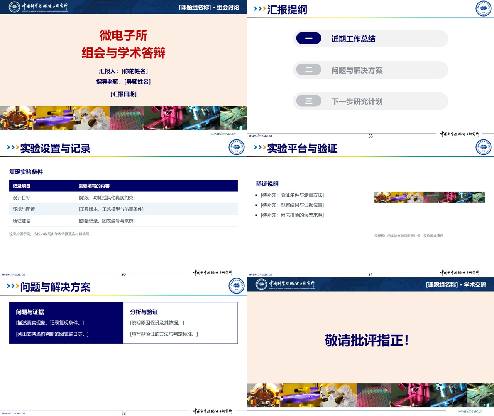
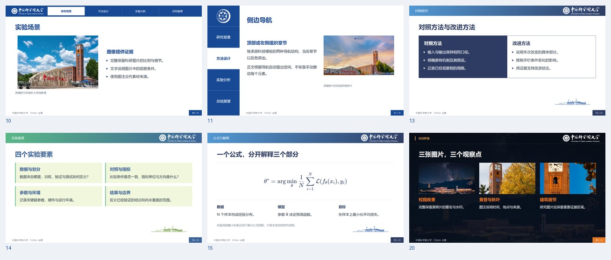

# slidev-theme-ucas

[简体中文](README.md) · [English](README.en.md)

**An unofficial multi-style Slidev theme for the University of Chinese Academy of Sciences (UCAS).**

Adapted from the supplied UCAS PowerPoint collection and IMECAS research-meeting master for coursework, paper reviews, research meetings and thesis defenses. Text, equations, tables and data stay editable.

[Live demo](https://roxyxu151.github.io/slidev-theme-ucas/1) · [Repository](https://github.com/RoxyXu151/slidev-theme-ucas) · [Use this template](https://github.com/new?template_owner=RoxyXu151&template_name=slidev-theme-ucas) · [Authoring skill](.agents/skills/ucas-slidev/SKILL.md)


> Theme code is MIT licensed. Extracted university marks, photographs and silhouettes retain their original rights and are excluded from that grant. Source PPT/ZIP/PDF files and fonts are not redistributed. See [NOTICE.md](NOTICE.md). UCAS is distinct from USTC.

## Styles and layouts

| `style` | Visual system |
| --- | --- |
| `minimal-blue` | Blue gradient and campus silhouette, default |
| `minimal-red` | Red gradient |
| `minimal-green` | Green gradient |
| `tech` | Technology blue with top or side section navigation |
| `diagonal` | Campus photography and blue geometric composition |
| `night` | Night photography, dark surfaces and orange emphasis |
| `autumn` | Autumn photography and warm brown/orange |
| `sunset` | Clock tower, autumn foliage and sunset composition |
| `ime` | Institute of Microelectronics: cream cover, laboratory photo strip, navy title band and section agenda |

Use `style: ime` for the Institute of Microelectronics (IMECAS). The cover's `section` field can name the research group; `sectionIndex` highlights the current agenda item. Body titles occupy the original template's header band and should fit on one line. `footer: false` hides the footer, `showPageNumber: false` hides its number, and a custom `footer` string replaces the website text.





Fourteen layouts cover titles, contents, dividers, body text, two columns, comparisons, left/right images, large figures, three-image galleries, three stages, four viewpoints, equations/key figures and closing slides. See the [layout contract (Chinese)](.agents/skills/ucas-slidev/references/layouts.md).

## Start locally

Requires Node.js **22.18+**, npm and locally installed Chinese fonts.

```bash
git clone https://github.com/RoxyXu151/slidev-theme-ucas.git
cd slidev-theme-ucas
npm ci
npm run dev
```

Edit `example.md` for the 34-page showcase, or run `npm run dev:starter` to edit `slides.md`. Save Markdown to update the browser. Press `P` for presenter notes or `O` for the overview.

Create an independent report:

```bash
npm run create:deck -- ../my-ucas-report --template paper --style tech --theme .
cd ../my-ucas-report
npm install
npm run dev
```

Starters: `paper` (12 pages), `meeting` (8), `defense` (9, default). Adjust the page count to your actual material. The initializer refuses nonempty destinations and does not install dependencies. Store your images in the new report's `public/` folder.

## Existing Slidev projects

Install the fixed GitHub release archive. This project does not assume that a similarly named npm package is ours.

```bash
npm install https://github.com/RoxyXu151/slidev-theme-ucas/releases/download/v0.3.0/slidev-theme-ucas-0.3.0.tgz
```

```yaml
---
theme: ucas
lang: zh-CN
themeConfig:
  style: tech
  sections: ['Background', 'Methods', 'Results', 'Conclusion']
  footer: University of Chinese Academy of Sciences
---
```

Use `theme: ./` inside the theme repository. Per-slide options override `themeConfig`, including explicit `false`. Set `footer: false` to hide the footer or `showPageNumber: false` to hide page numbers. Tech supports `navigation: side`; `sectionIndex` is one-based. Navigation labels indicate the current section; TOC page links provide navigation.

Default canvas: 16:9, 1280×720. Set `aspectRatio: 4/3` in the first headmatter for 4:3. Figures default to `contain` to preserve evidence. Chinese fonts fall back to Microsoft YaHei, PingFang SC and Noto Sans CJK. No online fonts are fetched.

## AI authoring and skill

Give your assistant [AI_PROMPT.md (Chinese)](docs/AI_PROMPT.md), verified materials and the current Markdown. Missing information stays in brackets; demonstration data is not a research result.

The portable [ucas-slidev skill](.agents/skills/ucas-slidev/SKILL.md) includes starters, initialization and the report checker. Install it with:

```bash
node .agents/skills/ucas-slidev/scripts/install_skill.mjs
```

Default destination: `~/.codex/skills/ucas-slidev`. Existing directories are never overwritten; use `--dest` for another location. Reopen the session if discovery has not refreshed. Invoke `$ucas-slidev` with your actual material and presentation requirements.

## Verify and export

```bash
npx playwright install chromium
npm run check -- slides.md --strict
npm run build:starter
npm run export
```

Add `--browser chrome` when using an existing Chrome installation. Linux may need `npx playwright install --with-deps chromium` and Noto Sans CJK fonts.

The checker writes HTML, JSON and page screenshots under `.slidev-check/<entry-name>/`. It checks boundaries, header/sidebar/footer collisions, missing images, clipping, long titles and TOC targets. It does not validate research facts, every animation state or PPTX output.

`npm run build:site -- --base /slidev-theme-ucas/` builds Pages with direct slide URLs. `npm run test:skill` checks initialization and fault detection; `npm test` checks rendering, independent installation and scenarios. `npm run export:example` exports the full showcase to editable PPTX; `npm run export:example:pdf` exports PDF.

`npm run export` defaults to **editable PPTX** (`slides.pptx`). Use `npm run export:pdf` for `slides.pdf`. The theme also defaults Slidev export to `pptx-editable`; an explicit format overrides it. Text, basic shapes and images remain editable where supported. The showcase's complex formulas become images; tables become editable text and shapes rather than native PowerPoint tables. Gradients and clipping may also become images, and recipients need the corresponding fonts. Inspect the actual PPTX and keep Markdown as the source for future Slidev edits.

The built-in browser `/export` page still produces image-based PPTX and does not use the CLI format default. Use `npm run export` for editable PPTX.
