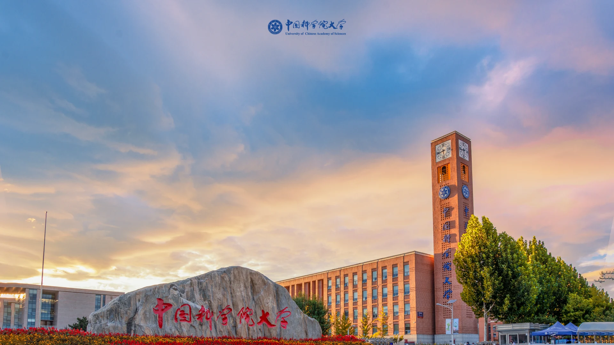
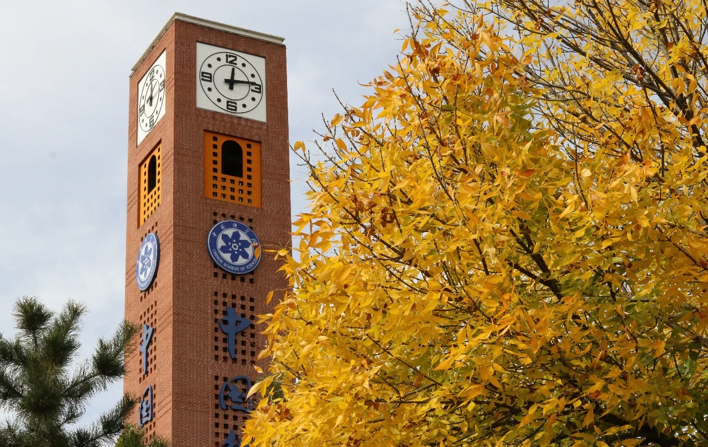
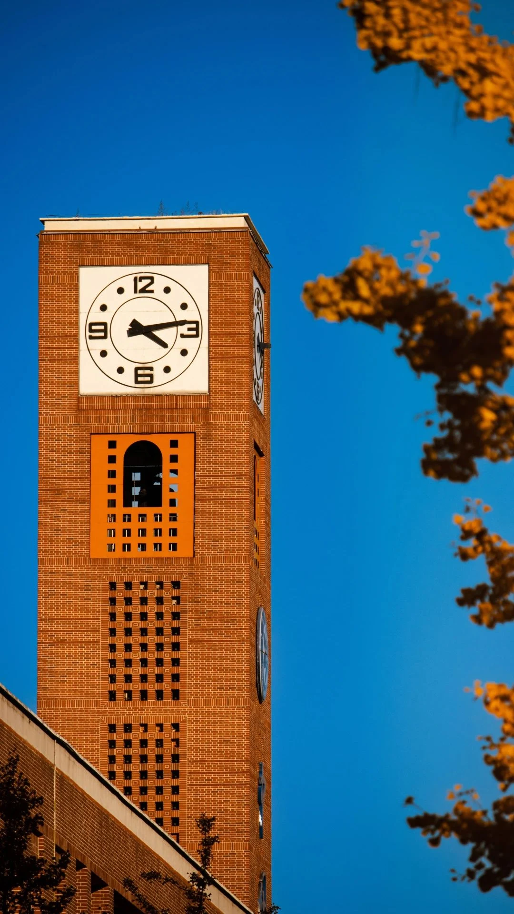
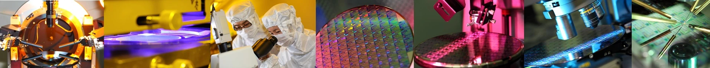

# 中国科学院大学<br>学术汇报主题

<!-- 原包包含简约、科技和校园照片风格。这里展示的是可编辑的网页主题，不是整页图片。 -->

---
layout: toc
---

1. [设计与来源](3)
2. [科技风与正文布局](7)
3. [校园照片风格](17)
4. [科研内容与交付](24)

---
layout: section
number: '01'
subtitle: DESIGN & SOURCES
---

# 设计与来源

---
section: 设计与来源
---

# 从原模板保留视觉特点

<p class="ucas-lead">渐变、校园剪影、导航与校园影像</p>

- 八种国科大风格来自原模板集合，另附微电子所组会风格。
- 文字、图表、公式和数据保持可编辑。
- 使用本地中文字体回退，无需在线字体或图片。
- 可用于论文阅读、组会、课程展示与学位答辩。

<p class="ucas-note">本主题为非官方社区改编。原模板照片、标识与剪影不属于代码的 MIT 授权范围。</p>

---
layout: cover
style: minimal-red
presenter: '[你的姓名]'
date: '[汇报日期]'
subtitle: MINIMAL RED
---

# 红色政务风<br>简洁的报告封面

---
layout: cover
style: minimal-green
presenter: '[你的姓名]'
date: '[汇报日期]'
subtitle: MINIMAL GREEN
---

# 绿色青春风<br>校园活动与课程展示

---
layout: cover
style: tech
presenter: '[你的姓名]'
advisor: '[导师姓名]'
subtitle: THESIS DEFENSE
---

# 科技风与正文布局

---
layout: toc
style: tech
---

1. [研究背景](9)
2. [实验场景](10)
3. [侧边导航](11)
4. [方法流程](12)

---
layout: section
style: tech
number: '02'
subtitle: BACKGROUND & METHODS
---

# 研究背景

---
layout: image-left
style: tech
section: 实验场景
sections: ['研究背景', '方法设计', '实验分析', '总结展望']
sectionIndex: 1
caption: 原模板中的国科大校园影像
---

## 图像提供证据

- 完整保留科研图片的比例与细节。
- 文字说明图片中的观察条件。
- 使用图注交代素材来源。

::title::

# 实验场景

::image::


---
layout: image-right
style: tech
navigation: side
section: 侧边导航
sections: ['研究背景', '方法设计', '实验分析', '总结展望']
sectionIndex: 2
caption: 原模板中的校园钟楼照片
---

## 顶部或左侧组织章节

继承原科技模板的两种导航结构，当前章节以反色突出。

正文根据导航自动留出空间，不依靠手动挪动每个元素。

::title::

# 侧边导航

::image::



---
layout: steps
style: tech
section: 方法流程
---

# 方法流程

::first::

## 明确输入

界定研究对象、数据来源与必要假设。

::second::

## 解释计算

说明核心机制、关键参数与设计依据。

::third::

## 验证输出

给出评价方式、对照条件与失败边界。

::note::

流程为排版示例，不代表已完成的研究工作。

---
layout: compare
section: 对照研究
---

# 对照方法与改进方法

::left::

## 对照方法

- 输入与输出保持相同口径。
- 明确原有机制及其假设。
- 记录已经观察到的局限。

::right::

## 改进方法

- 说明本次改变的具体部分。
- 排除评价条件变化的影响。
- 用证据支持改进结论。

---
layout: grid
style: minimal-green
section: 实验要素
---

# 四个实验要素

::first::

## 数据与划分

数据来自哪里，训练、验证与测试如何区分？

::second::

## 对照与指标

比较条件是否一致，指标单位与方向是什么？

::third::

## 参数与环境

记录关键超参数、硬件与运行环境。

::fourth::

## 结果与边界

区分已经验证的结论和尚未覆盖的范围。

---
layout: focus
section: 公式与解释
---

# 一个公式，分开解释三个部分

::focus::

$$
\theta^*=\arg\min_\theta\frac{1}{N}\sum_{i=1}^{N}\mathcal{L}(f_\theta(x_i),y_i)
$$

::explanation::

- **数据** N 个样本构成经验分布。
- **模型** 参数 θ 决定预测函数。
- **目标** 在样本上最小化平均损失。

::note::

经验风险最小化表达用于展示公式排版，不是本项目的研究成果。

---
layout: focus
style: night
section: 结果展示
---

# 关键数字与适用条件

::focus::

<UcasMetrics :items="[
 { value: '128', label: '样本量', detail: '演示数据 · 例' },
 { value: '86%', label: '指标示例', detail: '演示数据 · 非实验结果' },
 { value: '3.2 s', label: '耗时示例', detail: '演示数据 · 需说明环境' }
]" />

::explanation::

对真实结果，应同时提供数据划分、单位、评价口径与原始来源。

::note::

本页全部数值仅演示组件样式，不代表真实实验。

---
layout: cover
style: diagonal
presenter: '[你的姓名]'
advisor: '[导师姓名]'
subtitle: CAMPUS PHOTOGRAPHY
---

# 校园照片风格<br>图像与几何构图

---
layout: figure
style: diagonal
section: 大图与图注
caption: 原 PPT 模板中的国科大校园校门与钟楼
---

# 大图展示研究对象

::figure::


---
layout: cover
style: night
presenter: '[你的姓名]'
date: '[汇报日期]'
subtitle: UCAS AT NIGHT
---

# 国科大夜景<br>深色学术报告

---
layout: gallery
style: night
section: 校园影像
---

# 三张图片，三个观察点

::first::


## 校园夜景

完整保留原照片的署名与水印。

::second::



## 黄昏与秋叶

图注说明时间、地点与来源。

::third::



## 建筑细节

研究图片应保留重要证据区域。

---
layout: cover
style: autumn
presenter: '[你的姓名]'
advisor: '[导师姓名]'
subtitle: UCAS IN AUTUMN
---

# 国科大金秋<br>校园与研究生活

---
layout: image-left
style: autumn
section: 纵向照片
caption: 原 PPT 模板中的钟楼与秋叶
---

## 纵向照片与横向画布

保留照片比例，通过左右分栏组织图片与说明。

<UcasCallout title="科研图片">默认使用 contain 完整显示。只有装饰照片才选择 cover 裁切。</UcasCallout>

::title::

# 纵向照片也有合适的位置

::image::


---
layout: cover
style: sunset
presenter: '[你的姓名]'
date: '[汇报日期]'
subtitle: SUNSET AT UCAS
---

# 落日国科大<br>夕阳雁栖湖

---
style: sunset
section: 科研内容与交付
---

# 科研内容与交付

<UcasTimeline :items="[
 { date: '准备阶段', title: '整理材料', description: '收集真实论文、数据与图片来源。' },
 { date: '编写阶段', title: '生成初稿', description: '按内容选择布局，填写 Markdown。' },
 { date: '检查阶段', title: '逐页核对', description: '修正边界、事实与目录跳转。' },
 { date: '交付阶段', title: '展示分享', description: '使用网页演示，按需导出 PDF。' }
]" />

<p class="ucas-note">流程为主题使用示例，不是自动化科研流程。AI 不能替代作者核对研究事实。</p>

---
layout: two-cols
style: tech
section: 可编辑科研内容
---

# 表格与代码保持可编辑

::left::

## 实验记录

| 要素 | 记录内容 |
| --- | --- |
| 数据 | [来源与划分] |
| 环境 | [硬件与依赖] |
| 配置 | [参数与种子] |

::right::

## 简单代码

```python
def mean(values):
    return sum(values) / len(values)
```

<p class="ucas-note">仅为排版示例，省略空输入处理。</p>

---
layout: end
style: tech
presenter: '[你的姓名]'
advisor: '[导师姓名]'
subtitle: THANK YOU
---

# 感谢聆听<br>欢迎讨论

---
layout: cover
style: ime
footer: 中国科学院微电子研究所
section: '[课题组名称] · 组会讨论'
presenter: '[你的姓名]'
advisor: '[导师姓名]'
date: '[汇报日期]'
---

# 微电子所<br>组会与学术答辩

<!-- 此风格仅复用原 PPT 的母版设计和通用素材，不包含原文件的研究结果。 -->

---
layout: toc
style: ime
footer: 中国科学院微电子研究所
sectionIndex: 1
---

1. [近期工作总结](29)
2. [问题与解决方案](32)
3. [下一步研究计划](33)

---
layout: section
style: ime
footer: 中国科学院微电子研究所
number: '一'
section: 近期工作
subtitle: WORK SUMMARY
---

# 近期工作总结

---
style: ime
footer: 中国科学院微电子研究所
---

# 实验设置与记录

## 复现实验条件

| 记录项目 | 需要填写的内容 |
| --- | --- |
| 设计目标 | [频段、功耗或其他真实约束] |
| 环境与配置 | [工具版本、工艺模型与仿真条件] |
| 验证证据 | [测量记录、图表编号与来源] |

<p class="ucas-note">这是排版示例；占位内容需由作者依据真实材料填写。</p>

---
layout: image-right
style: ime
footer: 中国科学院微电子研究所
caption: 原模板中的实验室与晶圆照片条，仅作版式演示
---

## 验证说明

- [待补充：验证条件与测量方法]
- [待补充：观察结果与证据位置]
- [待补充：尚未排除的误差来源]

::title::

# 实验平台与验证

::image::



---
layout: compare
style: ime
footer: 中国科学院微电子研究所
---

# 问题与解决方案

::left::

## 问题与证据

[描述真实现象，记录复现条件。]

[列出支持当前判断的图表或日志。]

::right::

## 分析与验证

[说明原因假设及其依据。]

[填写拟验证的方法与判定标准。]

---
layout: steps
style: ime
footer: 中国科学院微电子研究所
---

# 下一步研究计划

::first::

## 补齐证据

[明确仍需采集的数据与实验条件。]

::second::

## 对照验证

[填写对照方案与评价标准。]

::third::

## 整理汇报

[记录结论、限制与后续工作。]

---
layout: end
style: ime
footer: 中国科学院微电子研究所
section: '[课题组名称] · 学术交流'
---

# 敬请批评指正！
